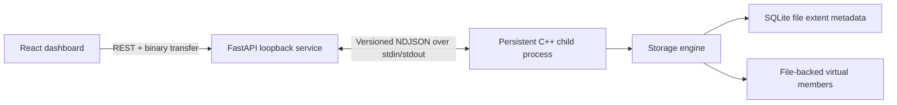
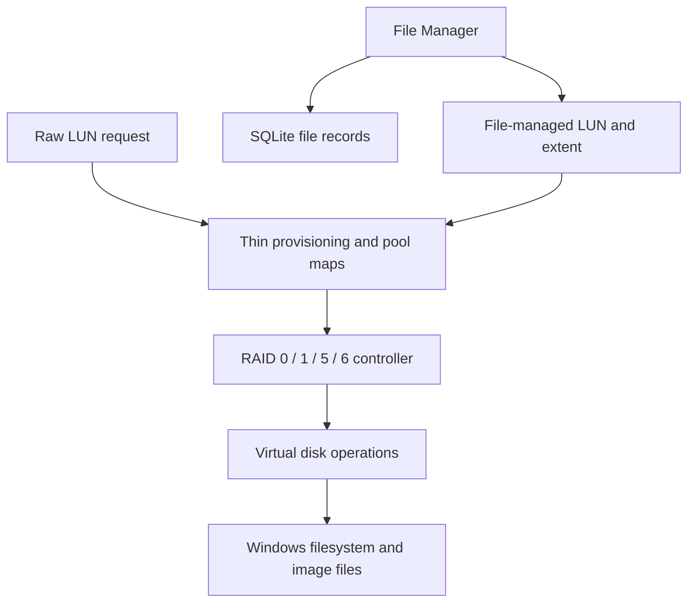
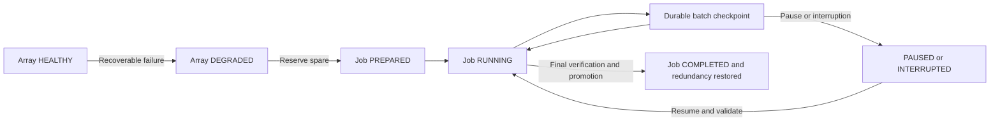
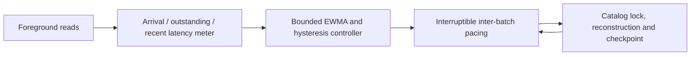
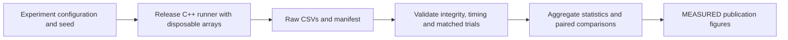

# Architecture

The C++ CLI and FastAPI share the storage manager APIs. In development, Vite proxies the React dashboard’s `/health` and `/api` requests to FastAPI. Hash routes select views, and TanStack Query caches reads and polls rebuild jobs with active workers. The engine remains authoritative for health, mapping, and allocation. [Dashboard architecture and testing](dashboard.md)

## Data flow

```text
HTTP client / React
          |
          v
FastAPI Backend
          |
          v
EngineClient (NDJSON pipes)
          |
          v
Persistent C++ process
          |
          +-- Virtual Disk Manager
          +-- RAID Array Manager
          +-- Failure & Rebuild Manager
          +-- Provisioning Manager
          +-- File Manager
          |
          v
File-backed virtual disks and SQLite
```

FastAPI validates request and response schemas and uses a bounded NDJSON transport. The child uses an explicit storage root and calls the managers directly. Each dispatch opens short-lived manager sessions so the RAID lock releases after the operation. The engine process stays alive across requests. The backend stays the owner of the child and the storage engine stays the owner of persistent records.

Ordinary engine requests are serialized. Rebuild workers run outside that queue, retain Windows job leases, and save checkpoints through the existing recovery manager. Graceful shutdown waits for owned jobs to pause at a boundary or finish. The existing lease protocol detects interruption after forced process exit. File payloads spool to an exchange directory and pass through verified import and export. [IPC, HTTP contracts, and operational limits](api.md)

## Engine modules

- **Core** coordinates lifecycle and configuration. Initialization prepares the disk manager and the RAID array manager. Shutdown releases RAID controllers, flushes and closes the member images, and releases the catalog lock.
- **Virtual Disk Manager** maps supported IDs to files in the configured storage directory, discovers valid images, reports their geometry, and owns the open disks. **VirtualDisk** performs block I/O on each image.
- **RAID Array Manager** resolves members, enforces ownership, persists configurations, and opens controllers. RAID 0, RAID 1, RAID 5, and RAID 6 use the **RAID Controller** interface for geometry, mapping, logical I/O, availability, and verification.
- **Thin Provisioning Engine** will expose logical capacity and allocate backing chunks on demand. A logical-to-physical chunk map will track allocations, with unmapped reads returning zeroes. The default chunk size is 65,536 bytes.
- **Failure and Rebuild Managers** persist member failures, reserve spares, checkpoint reconstructed blocks, and commit verified membership changes under the RAID catalog lock.
- **Provisioning Manager** owns pool and LUN metadata, reserves physical chunks, and uses the owning RAID controller for every data transfer.
- **File Manager** reserves logical file extents in SQLite, streams data through file-managed LUNs, and verifies SHA-256 using Windows CNG.
- **Telemetry Engine** will record I/O timings, simulated service demand, and contention to support reproducible benchmarks. Shared helpers will live under `utils` when needed.

## Virtual disk format and I/O

An image is a raw binary file with no header. Its size is its logical capacity and must be a positive multiple of 4096 bytes. LBA 0 starts at byte 0. LBA `n` starts at `n × 4096`. A 100 MiB disk contains 25,600 blocks, ending at LBA 25,599. The engine checks bounds by subtracting the starting LBA from the disk's block count before multiplying by the block size. Each read or write transfers the requested contiguous block range.

Creation stages a file in the storage directory, seeks to its final byte, and writes a zero. Windows zero-initializes the gap. The engine flushes the staging file and publishes it with a same-directory rename that fails if the destination exists. A failed creation cleans up its own staging handle. A process interrupted before publication can leave a temporary file that disk discovery ignores.

The Windows file layer checks directory components for reparse points and holds them open during path operations. It opens images without following reparse points, checks for regular single-link files, and carries the validated handle into a binary C stream. The CLI maps a restricted disk ID to a filename, and its storage directory is resolved from the project root. The low-level C++ API accepts absolute image paths supplied by trusted code. Raw physical disks and system partitions are outside the simulator's storage model.

Explicit flush commits pending writes to the Windows filesystem. Closing is idempotent and releases the file even if flushing fails. A new simulator process discovers existing images using their filenames and sizes. The file layer permits one read/write handle per image at a time. Power-loss recovery, checksums, and hardware fault tolerance are outside this format.

## RAID geometry and I/O

**RAID 0** stripes units of `S` consecutive blocks across `N` equal-sized members. The member index is `(LBA / S) % N`, and the physical LBA is `(LBA / S / N) * S + LBA % S`, using integer division. With two members and the default `S = 16`, LBAs 0–15 map to member 0 LBAs 0–15, LBAs 16–31 map to member 1 LBAs 0–15, and LBAs 32–47 map to member 0 LBAs 16–31. The stripe unit must divide the member block count. Usable capacity equals the sum of member capacities. Requests crossing stripe boundaries are split into contiguous member I/Os. Missing members make the entire stripe set unavailable.

**RAID 1** uses exactly two equal-sized members. Each logical LBA maps to the same physical LBA on each member. Usable capacity equals one member's capacity. Its recorded stripe unit is 1 block. Verified writes complete and flush on both members. A read can use either available mirror. The unavailable-member demonstration changes session state only, and writes require both members. Full verification compares every byte in the two copies. RAID 0 verification samples a mapped block on each member and the last logical block.

### RAID 5 layout

RAID 5 uses at least three equal-sized members. Let `N` be the member count and `S` the stripe unit in blocks. Each row has `(N - 1) × S` logical blocks plus one parity unit. `S` defaults to 16 and must divide the member block count, so every row is complete. Usable capacity is `(N - 1) × memberCapacity`.

For a logical LBA `L`, the row is `L / ((N - 1) × S)`. Let `offset` be the remainder of that division. The parity disk is `N - 1 - row % N`. The data disk is unit `offset / S` in the ascending sequence of physical disk indices with the parity disk skipped. Both positions use physical LBA `row × S + offset % S`. This layout is stored as `left_asymmetric_v1`.

```text
Row   Member 0   Member 1   Member 2   Member 3
0     D0         D1         D2         P
1     D3         D4         P          D5
2     D6         P          D7         D8
3     P          D9         D10        D11
```

Each label in the example represents a stripe unit. For four members and `S = 16`, LBA 20 maps to member 1 and parity to member 3, both at physical LBA 4.

### RAID 5 parity and I/O

The parity block at an offset is the byte-wise XOR of all data blocks at that offset. A missing data block is recovered by XORing the corresponding blocks on every surviving member, including parity. If the data member is available, it can be read directly even when parity is unavailable. Two unavailable members make the array unavailable. Degraded writes are rejected.

A partial row updates one block at a time with `newParity = oldParity XOR oldData XOR newData`. Each update reads the current parity, so multiple logical changes to the same parity offset accumulate in order. This is the conventional four-block-operation read-modify-write cost. A complete row computes XOR from the new data and writes data and parity in bounded batches with no old-block reads. A single logical request can include both strategies. The controller flushes touched members before clearing the write marker.

`raid verify` compares calculated and stored parity across all rows and counts each inconsistent row once. Equal parity establishes XOR consistency. Trusted end-to-end checksums are required to establish original data integrity.

### RAID 6 layout and field arithmetic

RAID 6 uses 4 through 257 equal-sized members. With `N` members and stripe unit `S`, each row has `(N - 2) × S` logical blocks, and usable capacity is `(N - 2) × memberCapacity`. The default `S` is 16 blocks. The unit must divide the member block count. For row `R`, the P member is `N - 1 - R % N` and the Q member is `(P + N - 1) % N`. Data units follow ascending physical member order with P and Q skipped.

```text
Row   Member 0   Member 1   Member 2   Member 3
0     D0         D1         Q          P
1     D2         Q          P          D3
2     Q          P          D4         D5
3     P          D6         D7         Q
```

For logical LBA `L`, let `width = (N - 2) × S`, `R = L / width`, and `offset = L % width`. The row's logical data-unit index is `offset / S`. The data, P, and Q positions all use physical LBA `R × S + offset % S`. This mapping is stored as `rotating_pq_ascending_data_v1`.

P is the XOR of corresponding data bytes. Q is the XOR of each data byte multiplied by `alpha^i`, where `i` is its logical data-unit index and `alpha = 0x02`. Addition and subtraction are XOR. Multiplication reduces polynomial products modulo `0x11D`, representing `x^8 + x^4 + x^3 + x^2 + 1`. The coefficient cycle has 255 distinct nonzero elements, so 255 data units plus two parity units are supported. Log and exponent tables implement the field operations.

### RAID 6 recovery and writes

When the requested data member survives, the controller reads it directly. With one missing data unit, it uses P and the surviving data when P is present. With P also unavailable, it divides the residual Q by the missing data unit's coefficient. With two missing data units, the controller removes surviving contributions to produce `P' = Da XOR Db` and `Q' = ca × Da XOR cb × Db`. It solves `Da = (Q' XOR cb × P') / (ca XOR cb)` and `Db = P' XOR Da`. The denominator is nonzero because the coefficients are distinct. RAID 5 supplies one equation for reconstruction. RAID 6 supplies two independent equations and therefore handles two unavailable members.

A partial-row update reads old data, P, and Q. It computes `delta = oldData XOR newData`, then XORs `delta` into P and `coefficient × delta` into Q before writing data and both parities. The conventional single-block path issues three reads and three writes. A complete row computes both parities from the new data in bounded batches and skips old-block reads. Mixed requests use the appropriate method for each row. Any unavailable member blocks writes. Three unavailable members block logical reads.

Full verification reads every row with all members available. It reports the number of rows with a P mismatch, a Q mismatch, and either mismatch. Multiple mismatching blocks within one parity unit count as one mismatch for that row. P/Q consistency and end-to-end integrity are separate checks.

## RAID metadata and ownership

Version 1 metadata lives in `data/metadata/raid_arrays/<array-id>.raid`. Every file contains the schema version, array ID, RAID level, comma-separated ordered members, block size, stripe unit, and capacity as ordered `key=value` lines. RAID 5 and RAID 6 store their respective `layout` fields. Arrays created from Step 6 also store ordered `member_identities`. Existing metadata reopens without migration. Geometry metadata becomes visible through a same-directory rename with replacement disabled.

The manager serializes catalog operations across simulator processes with a Windows file lock. Claiming members acquires their managed disk handles and scans them in bounded chunks before publishing the array. The scan checks for zero contents, and the catalog records ownership by disk ID. An all-zero disk can have been used previously. Existing ownership is respected even when a member image is missing. Raw simulator disk creation and writes check the catalog under the same lock, while raw reads remain available for inspection. Out-of-band edits to files are outside this ownership model.

Before a mirror or parity write changes any image, the manager publishes a pending marker. It clears the marker only after all required members flush. A failed write or interrupted process can leave the marker in place, and full verification also marks a detected mismatch. The array then reports **INCONSISTENT** and rejects logical reads, writes, and verification. Recovery from trusted data is required. Failure injection leaves pending markers intact.

For process interruption, a surviving marker blocks access even if some or all member writes finished. The simulator stores write intent and does not keep a data log for replay, roll back partially written blocks, or guarantee ordering across host power loss.

## Persistent member availability and health

The supported transition is `ONLINE → FAILED`. A failed member stays in the array's ordered membership and can retain an intact image. Controllers skip its image when reopening and never route logical I/O to it. `SPARE` and `REBUILDING` are reserved states. Array health is derived from availability and the separate write-consistency marker. The marker takes precedence and yields `INCONSISTENT`. Without it, zero unavailable members yields `HEALTHY`, an unavailable count within the level's tolerance yields `DEGRADED`, and a count above tolerance yields `FAILED`. Tolerances are zero for RAID 0, one for RAID 1 and RAID 5, and two for RAID 6. Healthy arrays support reads and writes, and degraded arrays support reads only.

`<array-id>.state` sits beside the geometry metadata. It contains `schema_version`, `array_id`, `members`, `member_states`, and `failure_causes` in order. A missing state file defaults members to `ONLINE`. The manager validates IDs, member ordering, state counts, and supported values before applying changes. The first failure cause is retained on duplicate requests. It stages and flushes the updated state, then publishes it with a same-directory rename under the catalog lock. A failed update leaves the preceding record intact. This avoids a torn state record during simulator interruption. Host power loss and external catalog changes are outside this guarantee.

The first successful observation of a missing member latches `FAILED/MISSING_IMAGE`. If the path reappears, it stays offline. New arrays bind each member to its Windows volume and file ID plus creation time, read from the validated image handle. This detects an unobserved same-path replacement and records `FAILED/IMAGE_CHANGED`. Legacy arrays lack an identity baseline, so a replacement that occurs before any missing observation can look like the original. File identity also does not detect in-place edits. A separate spare can become `ONLINE` through a verified rebuild.

## Hot spares and rebuilds

Spare registration checks the image geometry, file identity, modification time, and all-zero contents. Records live in `data/metadata/spares/`. Assignment requires an exact physical capacity match and repeats the checks before the first worker starts. Registration and job assignment reserve the disk against raw writes and conflicting ownership. Prepared jobs reserve their spares. Running, paused, and interrupted jobs keep their spares unavailable to foreground RAID I/O. A failed job retains its spare reservation. Another job for the array can be prepared with a different eligible spare.

Each version-1 job in `data/metadata/rebuild_jobs/` contains its array ID, physical member slot, member order, RAID geometry and layout, survivor identities and modification times, spare identity, status, batch size, timestamps, and durable physical-block checkpoint. The job transitions from `PREPARED` to `RUNNING`. Pause produces `PAUSED` at a batch boundary. Loss of the worker lease while the job is `RUNNING` produces `INTERRUPTED`. Either condition can resume after validation. A job finishes as `COMPLETED` once the replacement is promoted, or `FAILED` if reconstruction cannot safely continue.

`run` and `resume` start a C++ worker thread within the invoking CLI process and join it before returning. The worker holds a nonblocking Windows byte-range lease for the job and one read/write handle for the spare. Each batch acquires the existing catalog lock, opens the surviving members, performs the work, and releases those handles before releasing the lock. Foreground reads, status queries, and failure commands use the catalog lock between batches. A separate CLI persists pause requests. Observers test the job lease without waiting while they hold the catalog lock, avoiding a lock-order cycle. Degraded writes remain blocked. Changed survivor availability, identity, revision, or geometry stops the job.

The worker reconstructs bounded batches through VirtualDisk. It writes the spare, flushes it, compares the readback, then atomically publishes the checkpoint. Resuming may repeat a flushed batch if interruption preceded checkpoint publication. A final pass starts from the beginning, rederives every block, and compares it with the spare. Full reconstruction without promotion is shown below 100%.

- RAID 1 copies and compares the surviving mirror.
- RAID 5 XORs corresponding survivor blocks, which reconstructs either data or rotating parity. Comparing all spare blocks with the rederived bytes checks the complete stripe equations.
- RAID 6 reconstructs data through P, Q, or both, and regenerates a missing P or Q block from its data units. Final verification checks every applicable surviving parity equation. At the two-failure limit the available equations can determine the missing values without providing an additional independent check. After the second replacement, both parity equations can be verified across the healthy array.
- RAID 0 requires an external trusted source for recovery.

Promotion atomically replaces one version-2 array state record containing the effective ordered membership, identities, member states, and completed job IDs. The base `.raid` file remains readable and unchanged. The committed state makes the replacement active, retains its physical slot, and keeps any other failed member offline. Spare availability is derived from job assignments and committed membership. If interruption follows the membership commit but precedes the job status update, a later status query uses the committed job ID to finish that update safely.

Checks compare reconstructed data and parity against the available sources. Trusted end-to-end checksums are a separate concern. These checkpoints and commits cover process interruption under the simulator's catalog and locking model. Host power loss, out-of-band edits, abandoned-spare reuse, and foreground writes during rebuilding are outside the current protocol.

### Rebuild pacing

The worker initializes a scheduling controller from the prepared job. Schema-1 jobs default to full speed. Schema-2 jobs store validated policy parameters and reuse them across pause, shutdown, and restart. In-memory controller history starts fresh when the worker resumes.

The common decision is an inter-batch delay. The worker evaluates it after releasing the catalog lock and before opening the next batch session. The pause record and shutdown flag break the wait, and a new locked read confirms state before any work. The job lease and spare handle remain owned by the worker. Source validation, source reads, spare writes, flush, readback, checkpoint persistence, and final promotion stay in their original catalog scope. Each bounded wait admits another batch subject to the existing catalog lock and host scheduler. [Controller and measurement design](../benchmarks/docs/rebuild_methodology.md)

## Thin-provisioned storage pools

One pool owns one RAID array. Its record lives at `data/metadata/provisioning/<array-id>.pool`. The backing array's immutable geometry file is bound by Windows file identity and revision. For legacy RAID metadata, the pool captures available member file identities at creation. Member replacement through the existing rebuild protocol preserves the base array identity and the logical geometry, so the pool remains usable after verified promotion. The pool record is also the write-ownership marker. The array manager grants only the provisioning path the ability to write through its managed controller. Direct RAID reads remain available for diagnostics. Failure injection, health inspection, and verified rebuilds continue to use the RAID catalog.

Each pool uses one chunk size, with a default of 16 × 4096-byte blocks (64 KiB). Only complete chunks in the RAID logical address space participate. A LUN records its own logical capacity and sparse allocation map. Its logical chunk is `LBA / chunkBlocks`, its offset is `LBA % chunkBlocks`, and a mapped block is at `physicalChunk × chunkBlocks + offset` in RAID logical space. The allocator chooses the lowest free physical chunk and verifies exclusive ownership across every LUN and reservation. Multi-block requests split at chunk boundaries. Reads of unallocated ranges fill the requested bytes with zeros without reading RAID data or allocating storage.

Logical provisioned capacity is the sum of the sizes advertised to LUN users. RAID logical capacity reflects the usable address space after mirroring or parity. Physical pool capacity is that address space rounded down to complete chunks, divided among mapped, reserved, and free chunks. These counts describe space in a RAID pool. Actual host storage usage is determined by the member image files and filesystem. Utilization counts mapped and reserved chunks. Advisory warning and critical watermarks default to 70% and 90%, with `FULL` taking precedence at 100%. Overprovisioning uses the ratio of total provisioned blocks to usable pool blocks and can be capped at pool creation.

### Allocation and recovery

1. Acquire the existing cross-process catalog lock. Validate the pool record, backend identity, RAID health, logical range, and the space needed by the entire write.
2. Atomically publish one durable reservation listing all new chunks before modifying data. A capacity shortfall leaves all existing data and metadata untouched.
3. Write each new chunk in full through RAID with zeros outside the supplied data, including unwritten blocks in the first and last chunks. The existing RAID write path flushes the affected members and preserves its consistency journal. Already mapped chunks use ordinary RAID writes.
4. Once every transfer succeeds, replace the pool record atomically to publish all new mappings and clear the reservation together. If publication fails, existing mapped blocks may reflect completed RAID writes and the new mappings remain unpublished.
5. A restarted process validates any outstanding reservation before reporting its accounting. Reads continue to ignore reserved chunks. The next healthy write can replace the orphaned reservation while holding the lock. Reuse always writes a fresh, fully initialized chunk before publication. Conflicting or malformed records fail closed.

Healthy RAID allows LUN reads, writes, and allocation. Degraded RAID allows recoverable reads and blocks writes and allocations, including during rebuilding. Failed or inconsistent RAID blocks logical data access, including reads of unmapped regions. `pool verify` checks identity and metadata accounting, including map and reservation uniqueness and bounds. Trusted reference checksums are needed for end-to-end content integrity.

The recovery protocol covers simulator-process interruption. Power-loss durability depends on the host. Multi-chunk writes can change already mapped blocks before a later I/O failure. The simulator retains the backing RAID consistency marker when one exists. Metadata is limited to 8 MiB per pool, and one request may reserve up to 65,536 new chunks. Allocation uses the shared catalog lock for the duration of the request. Step 8 supports allocation only, including safe reuse of unpublished reservations.

## File catalog and RAID-backed file storage

```text
Host file
    |
    v
File Manager ------ SQLite file metadata and operation history
    |
    v
File-managed LUN
    |
    v
Thin provisioning
    |
    v
RAID controller
    |
    v
Virtual disk images
```

The disk, RAID, failure, spare, rebuild, pool, LUN, and allocation catalogs remain authoritative for the existing storage stack. SQLite at `data/metadata/storage_catalog.db` owns imported-file metadata, logical extents, reference hashes, and operation results. File bytes are stored in the LUN. SQLite never owns RAID health or physical chunk mappings. Existing catalogs open without migration.

The SQLite schema registers migration 1 in `schema_version` and validates the SQLite application ID and user version. `files` stores stable IDs, original basenames, exact lengths, reference hashes, timestamps, and import states. `file_extents` holds one contiguous, block-aligned extent per file. `file_operations` records imports, verification, exports, and failures. Strict types, foreign keys, constraints, and a trigger protect extent sizes and prevent overlapping reservations. File ID and LUN queries use indexes. An empty file has a zero-block extent and the standard empty-content SHA-256.

A new `FILE_MANAGED` LUN binds to the database's randomly generated catalog identity. The provisioning catalog writes version 2 when a pool contains a file-managed LUN and still reads version-1 raw pools. LUNs created without the file mode keep the original behavior. Raw writes to a file-managed LUN are rejected by the provisioning manager. Raw reads are available for diagnostics. Creating a replacement database does not authorize imports into LUNs bound to the prior catalog.

### Transactions and process interruption

1. Check the source and the backing LUN. In one SQLite `BEGIN IMMEDIATE` transaction, choose the next LBA from existing extents, insert the pending record and extent, and record the import operation. The append-only allocator includes incomplete and failed reservations.
2. Acquire the operation's nonblocking Windows file lease before committing the reservation. The lease remains held for the operation. No SQLite transaction stays open during file I/O. Provisioning and RAID use the existing shared catalog lock for each data request.
3. Read and hash the source in bounded 64 KiB buffers, pad the final block, and write through the LUN. Each underlying write returns after its RAID flush. The file advances through `WRITING` and `VERIFYING`. Read back and hash exactly the original length. Commit the reference hash, `COMPLETED` state, and operation result together only when the hashes match.
4. The next process that opens the catalog tests the leases of running operations without waiting. An operation with no holder becomes `INTERRUPTED`. An affected import becomes `FAILED` and retains its extent. Recovery never finalizes or recycles incomplete data.

SQLite uses its DELETE rollback journal, FULL synchronization, enforced foreign keys, and a two-second busy timeout. The Windows database path check pins the validated directory tree and main database file. Leave the database and any rollback journal under SQLite's control. The process must be able to open the catalog before recovering it. SQLite transactions and RAID writes have separate commit boundaries.

### Export and integrity

Import requires a healthy backing RAID array. Recoverable degraded reads support export and verification through the same LUN interface. Reads of failed or inconsistent RAID are rejected. File inputs and outputs use regular local files outside the simulator data directory. Export creates a same-directory temporary file, writes exactly the recorded byte length, verifies SHA-256, flushes, and publishes without replacement. A mismatch leaves the destination unpublished. An abrupt process exit can leave a named temporary file in the destination directory, and an exit after publication can leave a valid output whose operation is recorded as interrupted.

RAID verification checks mirror or parity consistency. File verification compares current bytes against the reference recorded at import. The reference lives in the same trust domain as the catalog and provides accidental corruption detection. Authenticity against an actor who can change the data and reference requires an independently trusted reference.

Step 9 uses one append-only extent per file. Deletion, trimming failed extents, and LUN resizing are unsupported. The provisioning snapshot limit remains 8 MiB per pool. Keep the SQLite database and the corresponding storage catalog together in backups taken while simulator operations are stopped. Recovery was designed for process interruption, with host power-loss behavior dependent on the filesystem, device, and OS.

## Measurement model

The standalone benchmark command uses the existing controller and provisioning entry points against explicitly isolated storage. Thread-local physical capture collects the foreground request's Step 12 disk events. The runner retains a bounded full-repetition vector for exact statistics and publishes run-specific CSV and JSON. [Benchmark methodology](../benchmarks/docs/benchmark_methodology.md)

The telemetry collector instruments VirtualDisk transfers, logical RAID controller transfers, and durable rebuild batch work. Its bounded in-memory snapshots preserve separate operation categories and origins. The performance model accepts explicit request and dependency lists and schedules hypothetical devices independently from measured execution. [Timing boundaries and counters](telemetry_methodology.md) · [Device profiles and FIFO scheduling](performance_model.md)

- **Actual file-backed I/O execution time** measures wall-clock time spent performing host file operations. Record cache and flush conditions alongside it.
- **Simulated multi-disk service time** models the work the virtual member disks would perform, including modeled concurrency between members.
- **Simulated queueing and contention** models waiting under competing foreground and rebuild traffic.

Record and label these measurements separately in telemetry and benchmark outputs.

RAID 5 and RAID 6 counters record completed blocks and requests at the VirtualDisk call boundary. A batched request can transfer multiple blocks. The counters exclude metadata operations, flushes, and host filesystem I/O. With four members and 16-block units, a RAID 5 one-block update uses two read and two write requests, and RAID 6 uses three of each. Full rows write 64 physical blocks in four requests with zero reads. The logical row widths are 48 blocks for RAID 5 and 32 blocks for RAID 6.


## Final system diagrams

### Application and process boundary



### Storage layers



### Failure and replacement



The array remains degraded while the job runs. A RAID 6 array with two failures can remain degraded after its first successful promotion.

### Adaptive scheduling



### Research pipeline



## Final feature matrix

| Feature | Status |
|---|---|
| File-backed 4 KiB virtual disks | Implemented and tested |
| RAID 0 stripe mapping | Implemented and tested |
| RAID 1 mirrors and rebuild | Implemented and tested |
| RAID 5 XOR parity, failure and rebuild | Implemented and tested |
| RAID 6 GF(2^8) P/Q, failure and rebuild | Implemented and tested |
| Persistent member failure, spare leasing, pause/resume and verified promotion | Implemented and tested |
| Thin pools, sparse reads, chunk allocation and logical overprovisioning | Implemented and tested |
| SQLite file metadata, binary import/export and SHA-256 | Implemented and tested |
| FastAPI/NDJSON and React dashboard | Implemented and tested |
| Measured telemetry and deterministic modeled device scenarios | Implemented and tested |
| Full-speed, fixed and adaptive rebuild pacing | Implemented and tested |
| Measured benchmark pipeline and figure regeneration | Implemented and tested |
| Foreground writes while degraded/rebuilding | Unsupported |
| File deletion and allocation reclamation | Unsupported |
| Independent physical-drive performance | Outside the measured scope |
| Public server deployment and authentication | Outside the local demonstration model |

[Faculty guide](FACULTY_DEMO_GUIDE.md) · [Validation report](FINAL_VALIDATION_REPORT.md)

